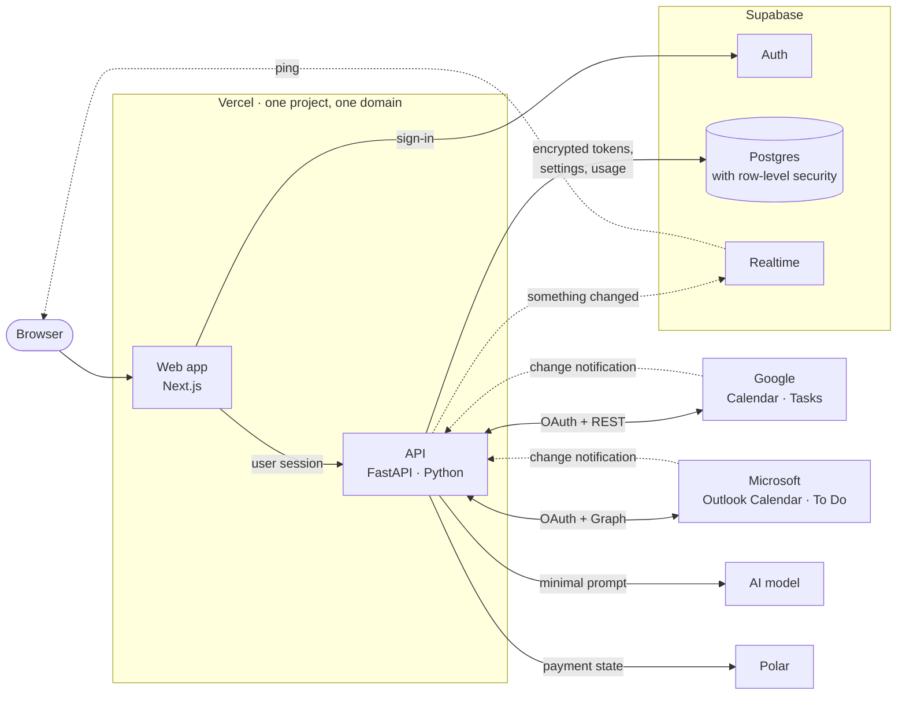
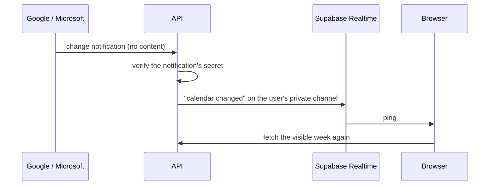

# Architecture

How Vekipper is built, and why. For what the product does, see the [README](README.md).

## 1. Overview

Vekipper has four parts: a web app, an API, a database, and the providers it connects to (Google, Microsoft and an AI model).

- **Web app.** Shows the data and sends actions (create an event, complete a task). It never talks to Google or Microsoft directly: everything goes through the API.
- **API.** Holds the complicated parts: OAuth for each provider, one connector per product, the merge of both providers into a single model, the AI features and billing. Each request carries the user's session token, and the API verifies it before doing anything.
- **Database.** Stores accounts, encrypted provider tokens, preferences and small counters. It does **not** store a copy of anyone's events or tasks (see [section 3](#3-two-way-sync)).
- **Providers.** Google Calendar, Google Tasks, Outlook Calendar and Microsoft To Do are the source of truth. The AI model only receives what a feature needs, and only when the user asks.

Web and API are deployed together as two services of one Vercel project. Requests under the API path go to FastAPI and everything else goes to Next.js. They share a domain, so there's no CORS. Every deploy ships both at once, so the web and the API are never on different versions.

## 2. Stack

| Part | Technology | Why |
|---|---|---|
| Web | Next.js 16 (App Router), React 19, TypeScript, Tailwind CSS 4, shadcn/ui, Motion | The interface had to be calm and polished, with fluid animation. shadcn/ui and Motion give that out of the box, and both are React-only. Server rendering serves the public site as static pages, and the app shell renders before the user's data arrives. |
| API | Python 3.12, FastAPI, Pydantic, httpx | The backend is where the hard problems are: OAuth, two providers with different data models, recurrence rules, time zones and AI output validation. Pydantic validates everything that comes in, from the browser, from Google and Microsoft, and from the model. FastAPI also produces an OpenAPI schema for the web to rely on. The project was also a deliberate way to learn Python properly. |
| Database and auth | Supabase (Postgres, Auth, Realtime) | Multi-user from day one without running infrastructure. Sign-in with Google or Microsoft, row-level security on every table, and a realtime channel to push notifications to the browser. It's standard Postgres, so it can be moved elsewhere. |
| Hosting | Vercel (web and API as services of one project) | One platform, deploys per branch (staging and production), a full preview for every pull request, and atomic rollbacks. Compared with Cloud Run, Railway and Render. The API is a plain FastAPI app, so moving it to a container later wouldn't require code changes. |
| AI | GLM 5.3 Flash via OpenCode, through the OpenAI Chat Completions format | Paid, fast and cheap, and the provider doesn't retain or train on the data. The OpenAI-compatible format means the model or provider can change through configuration, without code changes. |
| Payments | Polar (merchant of record) | Handles checkout, taxes, invoices and the customer portal. Payouts reach an individual in Colombia through Stripe Connect. Vekipper never sees card data. |
| Email | Resend | Waitlist confirmation and internal notifications, sent from the vekipper.com domain. |
| Analytics | Vercel Web Analytics, PostHog | Page views and a closed list of product events. No session recording, no autocapture, no heatmaps. |
| Tooling | pnpm + uv monorepo, GitHub Actions, Dependabot | Lint and tests for web and API on every pull request. Database migrations are versioned in git and applied by CI when code reaches staging or production. |

## 3. Two-way sync

The core rule: **Google and Microsoft are the source of truth. Vekipper keeps no copy of events or tasks.** Every read asks the providers, and every write goes straight to them. Because there's no second copy, there's nothing to reconcile.

### Reading

- The API reads Google and Microsoft in parallel and merges them into common `Event` and `Task` models. Each item carries its provider in its ID, so a later edit knows where to go.
- If one provider fails or needs reconnecting, the other is still shown, and the interface says which one failed and offers to reconnect.
- To keep this fast without a database copy, the API keeps short-lived in-memory caches in each instance: about 10 minutes for the list of calendars and seconds for a week's agenda. The browser prefetches the neighboring week. These caches are a speed-up, never a source of truth.

### Writing (Vekipper → provider)

- Writes go to the provider first. The interface updates optimistically, then confirms with a fresh read. If the provider rejects the change, the interface rolls back and says why.
- **Only changed fields are sent.** Editing an event's time doesn't resend its description. This matters because the providers store rich-text descriptions that Vekipper reads as plain text: resending an unedited description would wipe its formatting.
- Recurring events follow each provider's own model. Google uses iCalendar RRULE. Outlook uses its own pattern format, which the API translates both ways. "This and following" splits the series the same way the original apps do.

### Receiving changes (provider → Vekipper)

- **Calendars:** when the dashboard opens, the API subscribes to change notifications for each visible calendar: push channels on Google and subscriptions on Microsoft Graph. Each one carries its own secret, which the API checks on every notification.
- **The notification carries no data**, only "something changed". The browser then asks for that part again. Anyone who somehow listened to the channel would learn only that a change happened.
- **Renewal without a cron job.** Subscriptions expire after a few days. They're renewed when the user opens the dashboard and they're close to expiring. If nobody opens it, it doesn't matter that they lapse, because nobody is looking.
- **Tasks:** Google Tasks has no change notifications. While the tab is visible, the board refreshes every two minutes and when the tab regains focus. These quiet refreshes are also the safety net for calendars if a notification is lost.

### Conflicts

With no local copy, a conflict can only happen when the same item changes in two places at almost the same time. These are the rules:

1. **The provider decides.** A write that the provider accepts is the truth. Field-level updates mean that two edits to *different* fields of the same event (your time change in Vekipper, a colleague's location change in Outlook) both survive.
2. **Same field, last write wins**, as in the original apps. Vekipper doesn't add its own locking on top of the providers.
3. **Stale reads never overwrite fresh edits.** Each part of the screen keeps a version counter. A background refresh that started before a user edit is thrown away when it arrives, so it can't put the old state back on screen.
4. **Deleted elsewhere.** Editing an item that no longer exists reloads the view. Deleting one that's already gone counts as done.
5. **Vekipper never rewrites on its own.** If a task's date changes in Google Tasks, Vekipper doesn't move that task's time block in the calendar behind the user's back. It shows the new state and lets the user act.

### Tasks on the calendar

Neither Google Tasks nor To Do can store a time of day for working on a task. So when you drag a task onto the week, Vekipper creates a normal calendar event and tags it with the task's ID in a private property. Vekipper shows that event as the task: it has a checkbox, opens the task's dialog, and moving it changes the task's date. Outside Vekipper it's a regular event, so the time is visible everywhere. The link lives in the provider, not in Vekipper's database ([decision 1](#decision-1-no-copy-of-user-data-even-for-the-link-between-a-task-and-its-time)).

## 4. The AI agent

### What it does

Three features, all opened from a command center (Ctrl/⌘ + K):

| Feature | Input sent to the model | Output |
|---|---|---|
| **AI Calendar** | The sentence the user typed, the date and time zone, and the names of their calendars and lists | One or more proposed events and tasks |
| **AI Planner** | Pending tasks (title, due date, importance) and busy times **without event titles**, plus working hours and lunch | Proposed time blocks for today, each with a reason |
| **AI Summary** | Today's event titles and times, free gaps, the titles of tasks due or overdue, and whether it's a holiday A short briefing: what matters most and what can wait. Warnings (overlaps, back-to-back meetings in different places, tasks due without free time) and yesterday's leftovers are computed by the API, and the model only explains them |

Upcoming national holidays come from a holiday library, not from the model. The model is used only when the user chooses to review the events that fall on a holiday, and then it receives titles and times only.

### Model

**GLM 5.3 Flash**, served through **OpenCode** with low reasoning effort, so everyday requests stay fast and cheap. The API speaks the OpenAI Chat Completions format, so switching model or provider is a configuration change. Free tiers were ruled out because their terms allow using inputs to improve their products.

### What it can and can't do

- **It proposes, the user confirms.** No AI feature creates, changes or deletes anything. It returns a proposal, the user reviews and edits it, and saving goes through the same code paths as a manual edit.
- **Structured output only.** Every call asks for JSON with a fixed schema, and the API validates it with Pydantic. Then it cleans it up: valid dates and times, only calendars and lists that exist, and recurrence converted to rules the editor understands. Anything that doesn't fit is dropped before it reaches the user.
- **Hard limits in code, not in the prompt.** The planner's daily cap (2, 4 or 6 hours), working hours, lunch and gaps between blocks are enforced by the API. Free slots are computed by the API, which checks every proposed block, whatever the model says.
- **It asks instead of guessing.** If "at 3" could mean 3 a.m. or 3 p.m., AI Calendar asks.
- **User content is data, not instructions.** Prompts tell the model to ignore any instruction inside an event or task title. Since the model has no tools and its output is validated and confirmed, a hostile title can't make it act.
- **It explains only with what it was given.** Each planner block says why this task and why this time, based on the data sent. It doesn't invent history or "energy levels".
- **It can't** read email (Vekipper doesn't have access to email), see other users' data, call tools or act in the background.

### How the planner learns

The planner remembers per user, in their account, how many proposed blocks were accepted or rejected in each part of the day (morning, afternoon, evening). **Only counts are stored**, never titles, exact times or calendar content. When a part of the day is rejected often enough, the planner avoids it and tells the user ("I'm avoiding afternoons: you usually remove blocks there"). The user can reset it.

### Protecting user data

- **Minimum data per feature**, as listed in the table above. The planner doesn't receive event titles at all.
- **No training, no retention:** the provider was chosen because it doesn't retain or train on request data.
- **Nothing in logs:** prompts and responses are never written to application logs.
- **Usage, not content:** to enforce the daily limit (100 requests per Pro user, reset at the user's local midnight), the database stores how many requests a user made each day, never what they asked.
- **Pro only:** the AI is part of the paid plan, which also keeps cost proportional to revenue.

## 5. Technical decisions

### Decision 1: no copy of user data, even for the link between a task and its time

**Chosen:** read and write the providers live, and store the task-to-event link as a private property on the provider's event.
**Discarded:** mirroring events and tasks in Postgres (the usual "sync engine" design), and storing task times in Vekipper's own database.
**Why:** a mirror means a second source of truth, which needs a conflict model, backfills and deletion handling, and a database full of the most sensitive data the product touches. A time stored only in Vekipper would also disappear the moment the user opens Google Calendar. The cost: every view depends on provider latency and availability. Short caches, parallel requests, prefetching and tolerance of a single failed provider make up for it.

### Decision 2: removing email, a finished feature

**Chosen:** in v0.13, remove the Gmail and Outlook mail integration (inbox, triage, mail to task, real-time mail) and become a day planner.
**Discarded:** keeping email and going through Google's restricted-scope verification.
**Why:** Gmail access is a *restricted* scope. Opening it to the public requires a yearly third-party security assessment, with cost and weeks of waiting. Calendar and Tasks are *sensitive* scopes: they need verification, but no audit. Email was also the most sensitive data Vekipper held and the scariest line on the consent screen. And with three columns (mail, week, tasks) the product read as "three apps glued together". Without email, there was room for what makes it different: deciding what to do and when.

### Decision 3: web and API on the same platform and the same domain

**Chosen:** FastAPI deployed as a second service in the same Vercel project as the Next.js app.
**Discarded:** Google Cloud Run, Railway and Render as separate API hosts.
**Why:** one domain removes CORS and per-environment API URLs. One deploy ships both halves, so they can't drift, and the API doesn't need versioned URLs. Every pull request gets a full preview. At this scale it costs nothing extra. The trade-off: no always-on process, so real-time work runs on webhooks plus Supabase Realtime instead of open server connections, and scheduled work runs when users open the app instead of on a cron. The API is a standard FastAPI app, so moving it to a container is a deploy change, not a rewrite.

### Decision 4: AI that proposes, behind a provider-agnostic interface

**Chosen:** every AI feature returns a validated proposal that the user confirms, through an OpenAI-compatible interface with model, endpoint and key in configuration.
**Discarded:** an agent that writes to the calendar directly through tool calls, and free model tiers.
**Why:** an AI that changes your calendar on its own is scary, and it will be wrong sometimes. Requiring confirmation turns a wrong answer into a draft. Validating output with Pydantic in code, not with prompt instructions, means the model can't produce something the app can't handle. The neutral interface meant the model could change without touching code, and each new feature is a schema, a prompt and a validator that can be tested without calling the real model.

## 6. Security and privacy

**Tokens**
- Sign-in and connecting a calendar are separate steps. Signing in with Google or Microsoft only creates a session. Calendar and task access is granted explicitly afterwards, with only the scopes needed: calendar and tasks, never email.
- Provider refresh and access tokens are **encrypted at rest with authenticated encryption**. Only the API holds the key, and only the API can read them. A tampered value can't be decrypted.
- The OAuth flow is bound to the browser that started it. A sealed, short-lived state and a matching value in a cookie prevent someone else's browser from finishing a connection you started, or the other way round.
- The API verifies every session token against the auth provider's public keys. It holds no shared secret with the frontend.
- Disconnecting a provider deletes its tokens and stops its change notifications.

**What Vekipper stores**
- The account: name, email and avatar from sign-in.
- Encrypted provider tokens and which scopes were granted.
- Preferences: appearance, the planner's working hours, and the per-part-of-day acceptance counts described above.
- AI usage counts per day (not content).
- Subscription state from Polar: plan, status and renewal date. Never card data.
- Feedback messages and waitlist emails.

**What Vekipper doesn't store:** events, tasks, their titles or descriptions. They pass through the API in memory and are cached for seconds to minutes.

**Isolation and hardening**
- Row-level security on every table: each user can only read their own rows.
- The realtime channel is private per user and carries no content.
- Incoming notifications from Google, Microsoft and Polar are checked against per-subscription secrets or signatures before anything happens.
- Security headers on every response, the interactive API docs disabled in production, and automated dependency updates.
- Product analytics never capture screen content or record sessions.

## 7. What I learned

**I built features before checking what it would take to open them to the public.** Email took three releases (Gmail, real-time mail, Outlook mail) and was removed five days after the first one, once I understood Google's restricted-scope audit. Reading the provider's verification requirements is now step zero for any integration.

**Verification is part of the critical path, not paperwork.** Google's data-access review and Microsoft's publisher verification take weeks, and they need a verified domain, a privacy policy that matches each scope, and a demo video. Until then, Google shows an "unverified app" screen and caps the app at 100 users. I shipped faster than the verifications could keep up, and in the end I closed the app behind a waitlist. Next time I'd start both verifications in the first week.

**Undoing features costs more than not building them.** Hashtag tags on tasks lasted one day, and the "Today" column five. The mobile web layout was built and then dropped for a future native app. Each one was reasonable on its own, but each left code, docs and landing copy to clean up. Writing an architecture decision record before building made these reversals cheaper, because the reasoning was there to revisit. I'd now also write the "what would make us remove this?" line before starting.

**Serverless cost depends on details that are easy to miss.** One shared layout read the user's session, which quietly made every visit to the public landing page run a server function. Moving that read to the authenticated part of the app made the landing fully static and stopped it from using server CPU on every visit. I'd check which pages are static from the first deploy, not after the fact.

**Don't depend on webhooks arriving.** Payment webhooks can arrive after the user returns from checkout, and calendar notifications can be lost. Every webhook in Vekipper has a fallback: a direct check with Polar when the user comes back from paying, and quiet periodic refreshes for calendars and tasks.

**Test against real accounts early.** For a while, the Microsoft connectors were tested only against mocked responses. Testing with a real account was what built confidence, and work and school tenants with admin-consent policies are still the least-tested path. I'd set up real test accounts for every provider before writing the first connector.
