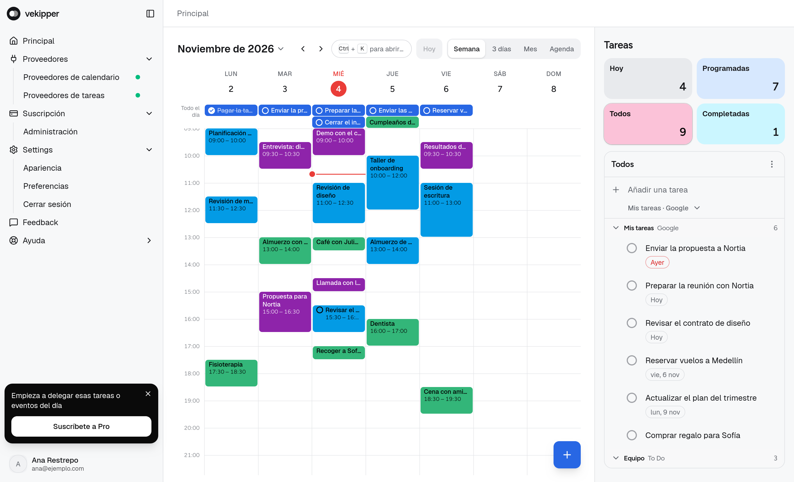
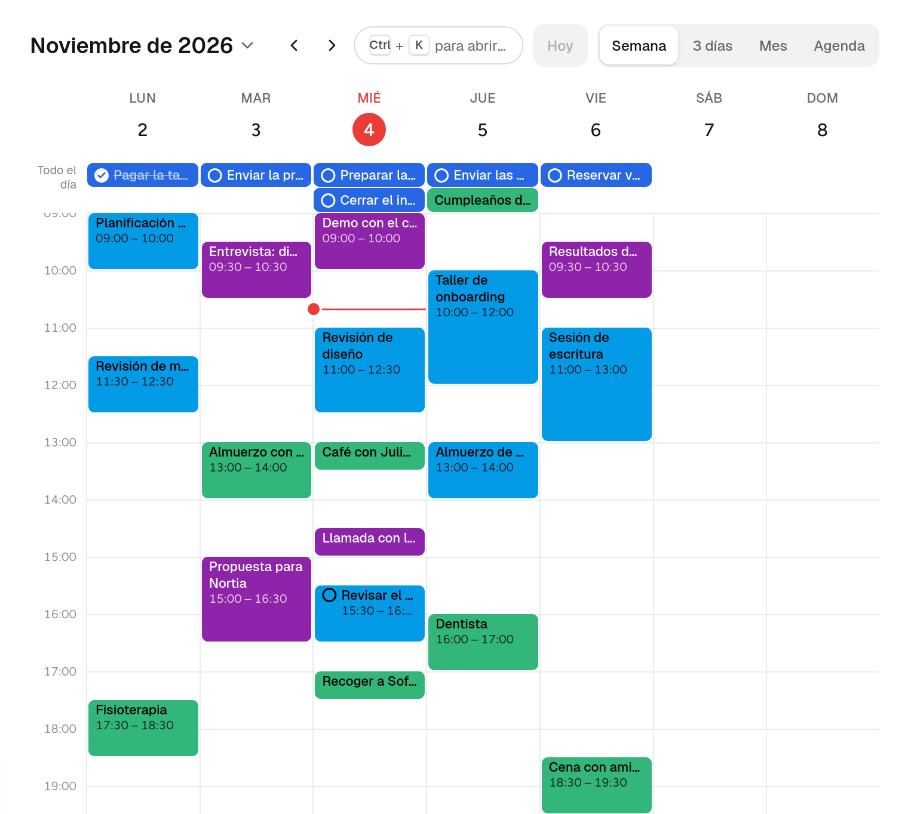
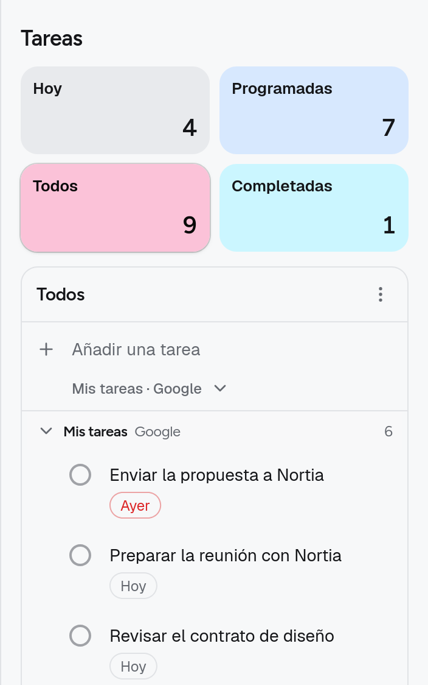

  <picture>
    <source media="(prefers-color-scheme: dark)" srcset="assets/logo/logo-light-text.svg">
    
  </picture>

<strong>Your calendar and your tasks from Google and Microsoft, planned together on one screen.</strong>

  <a href="https://vekipper.com/en">vekipper.com</a> ·
  <a href="ARCHITECTURE.md">Architecture</a> ·
  <a href="CHANGELOG.md">Changelog</a>

---

Vekipper is a day planner for the web. It brings Google Calendar, Outlook Calendar, Google Tasks and Microsoft To Do into one view that you keep open all day. You see what's on today, plan the week and block time for your tasks. Everything stays in sync with the original apps, in both directions.

All screenshots use demo data. The app's interface is currently in Spanish.

## Links

| | |
|---|---|
| Website (English) | [vekipper.com/en](https://vekipper.com/en) |
| Website (Spanish) | [vekipper.com](https://vekipper.com) |
| App | Closed until the relaunch. [Join the waitlist](https://vekipper.com/en/waitlist) |

## The problem

You open your laptop and your day is split across several apps: the calendar in one tab, the tasks in another, and work and personal life often on different providers. You can see what you have, but not **when** you'll actually do each thing. The apps that try to unify everything usually add dozens of features you'll never use, and many ask you to move your data into them.

Vekipper is for people who live between their calendar and their to-do list on Google, on Microsoft or on both, and want to plan the day in one clean view **without leaving the apps they already use**. Google and Microsoft remain the source of truth. Vekipper reads from them and writes back to them.

## What it does today

**Calendar (Google Calendar and Outlook Calendar)**
- Week, 3-day, month and agenda views, with every visible calendar from both providers merged by time and colored by calendar.
- Create, edit, delete and RSVP to events. The editor covers what each provider's own editor does: recurrence (this event, this and following, or all events), guests, Google Meet or Teams, notifications, availability, visibility and time zone. On Google you also get guest permissions, event colors and moving an event to another calendar.
- Drag across the grid to create, drag to move and resize, with undo. Keyboard shortcuts for every view.

**Tasks (Google Tasks and Microsoft To Do)**
- Every list from both apps on one board: Today, Scheduled, All and Completed.
- Subtasks, due dates and reordering on Google Tasks. Steps, importance, reminders and repeats on To Do.
- Move a task from Google Tasks to To Do and back.

**Planning**
- Drag a task onto the week to block time for it. The block *is* the task: you can complete it, open it and move it from the calendar, and its due date follows.
- Live updates: calendar changes made on your phone or in Outlook show up in seconds, without reloading.

**AI (Pro plan)**, through a command center (Ctrl/⌘ + K). It proposes and you confirm. It never changes your calendar on its own.
- **AI Calendar:** type "Lunch with Laura on Thursday at 1" and get an event or task to review. It handles several items in one sentence and asks when a time is ambiguous.
- **AI Planner:** proposes time blocks for today's pending tasks inside your working hours, never over lunch. It explains each block and learns which parts of the day you keep rejecting.
- **AI Summary:** your day at a glance on the first visit of the day: what matters most, overlapping meetings, tasks due without free time, and what was left over from yesterday.
- **Holiday check:** warns you about upcoming national holidays and helps you review the events that fall on them.

**Account**
- Sign in with Google or Microsoft (personal, work or school accounts). Connecting a calendar is a separate, explicit step.
- Light, dark or automatic theme, hour height, 12/24-hour clock, weekends on or off, dimmed past events and a resizable task column, saved to your account.
- In-app feedback: report a problem or request a feature and follow its status.

Vekipper is built for desktop (1024 px and wider). A dedicated mobile app is planned instead of a mobile web version.

<table>
  <tr>
    <td width="60%"></td>
    <td width="40%"></td>
  </tr>
</table>

## Status

- **Stage:** private beta. Vekipper has run in production at vekipper.com since late October 2026, and the paid plan has been on sale since November 9, 2026.
- **Right now:** since November 14, 2026 the app is **closed to new and existing accounts** while Google and Microsoft review it (Google's data-access verification and Microsoft's publisher verification). The website collects a waitlist. People on the list get founder pricing: their first three months of monthly Pro at half price.
- **Pricing:**
  - **Free:** calendar, tasks, time blocking and live updates.
  - **Pro:** everything in Free plus the AI, for **USD 6/month or USD 60/year**. Payments, taxes and invoices are handled by [Polar](https://polar.sh) as merchant of record.
- **Activity:**
  - **31 versions in under four weeks**, from the first commit on October 22, 2026 to v0.23.1 on November 18, 2026. See the [changelog](CHANGELOG.md).
  - More than 150 commits.
  - 27 architecture decision records written as the project went.
  - Website in Spanish and English.

## Who builds it

Vekipper is built by **Andrés Contreras**, founder and sole developer, from Colombia. He designs it, writes the code (frontend, API, infrastructure) and answers every message sent through the feedback form. He started Vekipper to organize his own day.

GitHub: [@morganbyte](https://github.com/morganbyte)

---

The application's source code is private. This repository only holds public documentation about the product and how it's built.
